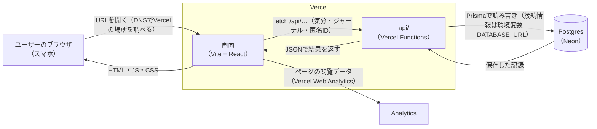

# NAGI

呼吸・自然音・言葉によるセルフケアで、頑張りすぎた心を「今日はここまででいい」と休ませるアプリ。

本番環境：[https://health-care-lime-beta.vercel.app](https://health-care-lime-beta.vercel.app)

## 1. 何を作ったか

寝る前にスマホで使う、心を整えるためのWebアプリです。

1. **今の気分を記録する**（一言とスコア、ストレス・元気・睡眠の度合い）
2. **今の状態に合ったケアを選ぶ**（入力内容から、おすすめのケアや音を提案）
3. **呼吸・自然音・言葉・ストレッチで心を整える**
4. **「今日はここまで」で終わる**（今日できたことを1つ記録して、「明日の自分に任せる」）

ほかにも、気分の振り返り（グラフ・週ごとのまとめ）、ジャーナル、気持ちを整理するためのAIチャットがあります。日本語・英語の切り替えと、ライト・ダークのテーマ切り替えにも対応しています。

## 2. なぜ作ったか

ターゲットは、大学受験を控えた高校生です。課題や周りからのプレッシャーに追われるうちに気持ちが追い詰められ、未来が見えなくなってしまう――そんな状態の人を想定しています。

大学受験を頑張りたい気持ちはあるのに、頑張りすぎて限界になってしまう。寝る前、家でスマホを見ながら「大学受験できるかな」と不安になる。そんな人に必要なのは、もっと頑張るための道具ではなく、**不安でいっぱいになった心を一度休ませて、「もう少しだけやってみよう」と思える状態をつくるもの**だと考えました。

だからNAGIは、何かを達成させるアプリではなく、「今日はここまででいい」と安心して終われるアプリにしています。

## 3. 工夫した点

- **しんどい人を突き放さない入力チェック**
  - 何も書かずに送ったときは、エラーではなく「今の気持ちを一言だけでも大丈夫です」とやさしく声をかけます。
  - 「辛い」「嫌だ」などのネガティブな言葉は、受け止めるためのアプリなので弾きません。弾くのは暴言・宣伝リンク・意味のない文字列だけです。
  - 長すぎる文章は、要点をまとめて記録します。
- **深刻な悩みには、安全を優先した案内**
  - 命に関わるような言葉を見つけたときは、否定せずに相談窓口（電話番号など）を案内します。AIチャットでも同じ対応をします。
- **途中で閉じても大丈夫**
  - それまでの記録を残しておき、次に開いたときに「続きから」か「最初から」を選べます。
- **ログイン不要**
  - 寝る前に開いてすぐ使えるよう、アカウント登録をなくしました。端末ごとの匿名IDで記録を管理しています。
- **自然音はブラウザの中で作っている**
  - 雨や波などの音を、音声ファイルを使わずに Web Audio でその場で合成しています。複数の音を重ねたり、音量を調整したりできます。
- **安全な作り**
  - ブラウザから直接DBに接続せず、必ずAPI（Vercel Functions）を通します。
  - APIキーやDBの接続情報はコードに書かず、環境変数で管理しています。

---

## 構成

- フロントエンド: Vite + React（`src/`）
- API: Vercel Functions（`api/`。ブラウザは直接DBに接続せず、必ずこの層を経由する）
- ORM: Prisma（`prisma/schema.prisma`）
- DB: Neon Postgres（Vercel Marketplace 経由で接続）
- AI: Gemini API（`api/chat.js`。AIチャットの返答に使用）
- 計測: Vercel Web Analytics（`@vercel/analytics`。`src/main.jsx` で読み込み）
- 共有ロジック: `shared/moderation.js`（入力バリデーション／モデレーションをフロントとAPIの両方で使用）
- 仕様書: `docs/01_spec.md`

## セットアップ

```bash
npm install
vercel link                  # Vercelプロジェクト（health-care）と紐づける
vercel env pull .env.local   # DATABASE_URL などの環境変数を取得
npx prisma db push           # スキーマをDBに反映
npm run dev                  # フロントエンドのみ（http://localhost:5173）
```

### 環境変数

| 名前 | 用途 | 備考 |
|---|---|---|
| `DATABASE_URL` | DB接続 | Neon連携で自動設定される。`vercel env pull` で取得 |
| `GEMINI_API_KEY` | AIチャット | 本番環境のみに設定済み。手元で試すときは [Google AI Studio](https://aistudio.google.com/apikey) で発行したキーを `.env.local` に追記する。未設定でもアプリは動き、AIチャットは「準備中」の案内を返す |
| `GEMINI_MODEL` | 使用モデルの差し替え | 任意。未設定なら `gemini-3.5-flash-lite` |

各値の書き方は `.env.example` を参照。

API（`api/`）はVercel Functionsのため、フロントとAPIを合わせて動かすには [Vercel CLI](https://vercel.com/docs/cli) を使う。

```bash
npm i -g vercel
vercel dev
```

## インフラ構成図


